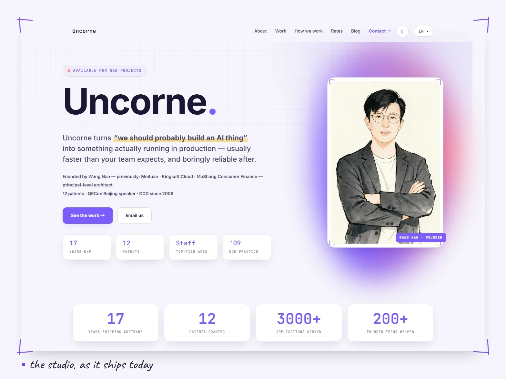
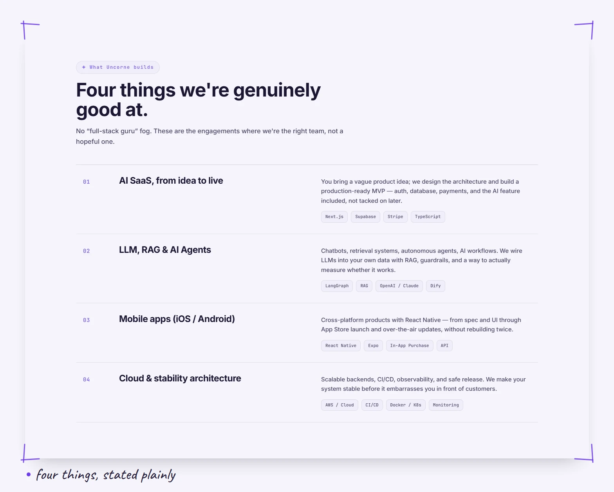
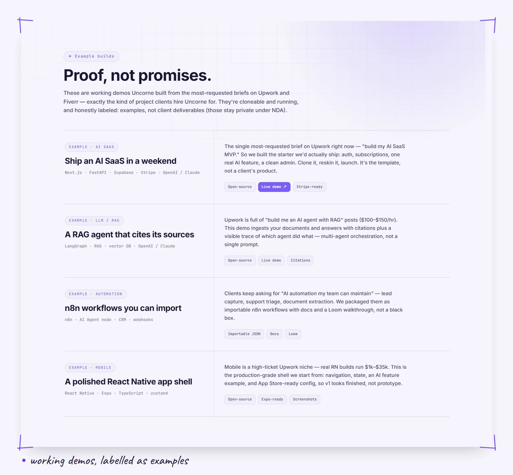
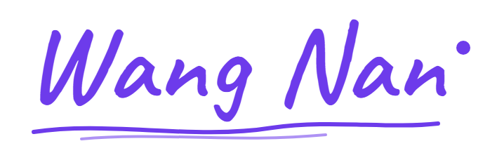

# WangNan

Software architect and founder. I run **Uncorne**, a small senior-led studio that builds AI SaaS, mobile apps and the cloud architecture underneath them 鈥?and I write about the decisions that decide whether a product actually ships.

> Not a copilot 鈥?the studio that owns the architecture decision.

## Uncorne 鈥?SaaS & AI studio

Uncorne is the studio I founded: one senior architect owning the whole stack instead of a handoff chain. The line on the site is the standard I try to hold 鈥?you get a system that survives scale, an audit, and the next engineer who touches it, not just a sprint's worth of code.

### What the studio takes on

- **AI SaaS, idea to live.** Architecture plus a production MVP: auth, database, payments, and the AI feature built in rather than bolted on. Next.js, Supabase, Stripe, TypeScript.
- **LLM, RAG and agents.** Retrieval over your own data with citations and guardrails, plus a way to measure whether the answers actually work. LangGraph, OpenAI / Claude, Dify.
- **Mobile apps.** React Native and Expo from spec through App Store launch, with over-the-air updates, so there is one codebase instead of two.
- **Cloud and stability.** Backends, CI/CD, observability and safe release for systems that need to stop being exciting. Java, Python, PostgreSQL, Docker / K8s.

### Who it is for

Founders, CTOs and small product teams who need the whole thing owned end to end, and who would rather hear "your v1 is too big" in week one than in month three. The practice is DDD, microservices and high-concurrency work going back to 2009; engagements run async-friendly across US and EU hours from GMT+8.

Background: 17 years shipping software, previously Meituan, Kingsoft Cloud and MaShang Consumer Finance; principal-level architect, 12 patents, QECon Beijing speaker.

### Ways to work with the studio

- **MVP sprint** 鈥?from **$3.9k**, fixed, 2鈥? weeks. Core flows only: auth, database, one AI feature, live in production, code and handover docs.
- **AI build partnership** 鈥?from **$110鈥?60/hr**, hourly. Full-stack and AI architecture, LLM / RAG / agent integration, weekly demos and code review.
- **Fractional architect** 鈥?from **$3k/mo**, monthly. Technical direction and reviews, hiring and team enablement, quarterly roadmap.

Rates are published on the site and benchmarked against 2026 Upwork data for senior AI and full-stack engineers. If the job is not a fit, the answer is no.

### Proof, honestly labelled

The work section holds working demos built from the briefs clients actually bring: an AI SaaS starter, a RAG agent that cites its sources, importable n8n workflows, and a React Native app shell. They are open-source examples, not client deliverables 鈥?client work stays private under NDA.

鈫?[uncorne.com](https://www.uncorne.com) 路 [About](https://www.uncorne.com/#about) 路 [Blog](https://www.uncorne.com/blog) 路 [Start a project](https://www.uncorne.com/#contact)

## make1day.dev

[make1day.dev](https://www.make1day.dev) is where the engineering notes live: hands-on writing about Next.js SaaS, Stripe billing, Supabase and GEO, plus the live demo of the AI SaaS starter. Articles are written against working code, with the contracts and edge cases checked before they are described.

## Play Hype Games

[Play Hype Games](https://www.playhypegames.com) is a free browser-game directory with editor notes, checked Roblox codes and open-source port notes. No downloads, no installs. Each game page includes controls, session notes and a cold-fetch test log.

## What I work on

- AI SaaS architecture and production MVPs 鈥?Next.js, Supabase, Stripe
- LLM retrieval and agent systems, with citations and an evaluation path
- React Native apps that ship to the App Store once, not twice
- Cloud architecture: CI/CD, observability, high-concurrency backends
- Technical writing with verifiable examples
- Browser-game catalogue curation, embed audits and performance checks

## Elsewhere

- [Play Hype Games author page](https://www.playhypegames.com/author/wangnan)
- [Browser game load-time index](https://www.playhypegames.com/research/browser-game-load-times)
- [How we choose the games we list](https://www.playhypegames.com/blog/how-we-choose-games)
- [X / Twitter 鈥?@nanwang_aitalk](https://x.com/nanwang_aitalk)

